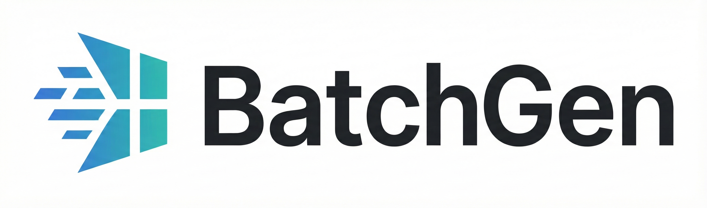

# BatchGen

<p align="center">
  
</p>

<div align="center">

[](https://github.com/batchgen-project/batchgen/stargazers)
[](https://opensource.org/licenses/Apache-2.0)

**High-throughput batch inference for large MoE models**

[Selected results](#selected-results) · [Support matrix](docs/support-matrix.md) · [Deployment guides](docs/) · [Batch API](docs/batch-api-guide.md) · [Contributing](CONTRIBUTING.md) · [Paper](https://www.usenix.org/conference/osdi26/presentation/xu-tairan)

</div>

---

## News

<!-- news-rewrite-ack 2026/11: owner-directed consolidation of the two 2026/09 GLM entries into one, and of the v1.1.0 + v1.1.1 entries into one v1.1.1 entry -->
- **2026/11 — BatchGen v1.2.0: Kimi-K3.1-Pro.** Day-one support for
  [Kimi-K3.1-Pro](https://huggingface.co/moonshotai/Kimi-K3.1-Pro) — Kimi-K3 with a
  gated sparse-attention indexer on its 24 full-attention layers — served on
  4×8 H20 through a dual-region KV cache (MLA latent + page-split FP8 index
  keys), sparse long-prompt prefill and CUDA-graph sparse decode, validated
  end to end (MMLU-Pro smoke and a 512-request mixed eval batch to
  completion). See the [deployment guide](docs/deploy-kimi-k3.1-h20.md).
- **2026/11 — BatchGen v1.1.1.** Kimi-K3 multi-node serving on a compact
  distributed weight store; GLM-5 with no runtime compilation (ahead-of-time
  kernels plus a startup prewarm covering every reachable Triton and DeepGEMM
  kernel); page-level prefix reuse; cluster fail-fast and a restartable worker
  pool; prebuilt Hopper (sm90a) wheels; published end-to-end batch-completion
  results with the [`benchmarks/`](benchmarks/) reproduction suite.
- **2026/09 — GLM-5.2-FP8 and GLM-5.3-FP8 on 8×H200.** One-node deployment
  guides, the dedicated GLM-5.3 chat template, reasoning parser and request
  controls, and source-qualified `8×1M` plus `32×256K` accumulated-token
  prefill. On the matched `8×1M` workload, BatchGen reached 20,648 prompt
  tok/s, **1.71× faster** than the best completed point in the recorded
  SGLang 0.5.18 tuning sweep.
- **2026/09 — Kimi-K3** (2.8T-parameter, 896-expert MXFP4, top-16) support —
  multi-node deployment on [2×8 H200](docs/deploy-kimi-k3-h200.md) or
  [4×8 H20](docs/deploy-kimi-k3-h20.md).
- **2026/01 — BatchGen v1.0** released with support for DeepSeek-R1/V3-671B.

## What is BatchGen?

BatchGen is a batch-inference engine for large language models, with a focus on sparse mixture-of-experts (MoE) models and long-context workloads. It minimizes **batch completion time (BCT)**—the time to finish a batch of requests—by coordinating sequence-level scheduling, expert-level batching, and host/device KV-cache movement across GPU clusters.

BatchGen is intended for both production users and researchers: the same batch API can drive offline generation, evaluation, synthetic-data pipelines, test-time scaling, and RL rollouts while exposing the scheduling and systems ideas needed for experimentation.

### Why BatchGen

- **Batch-first execution.** Optimize the completion time of a whole workload, not only single-request latency.
- **Long-context prefill.** Keep large prompt batches productive when model weights and KV state exceed a single GPU's capacity.
- **MoE-aware scheduling.** Reorganize sequence work to form larger expert-level batches and reduce long-tail stragglers.
- **Host KV cache.** Use CPU memory as an extension of the KV-cache hierarchy for workloads that cannot fit entirely on device.
- **Research-friendly controls.** The batch API and deployment scripts make it straightforward to reproduce experiments and compare scheduling policies.

## Selected results

The numbers below are workload-specific measurements, not a universal ranking. Comparisons use the same request set and report the measured wall-clock or throughput metric for that workload. “Faster” is computed as baseline divided by BatchGen.

### End-to-end batch completion (2026/11)

Batch completion time on identical request sets (same prompts, sampling, and
arrival order), with every baseline tuned on the same hardware and workload via
a recorded sweep; the baseline's best completed configuration is reported.
Full settings and reproduction scripts: [`benchmarks/`](benchmarks/).

| Model and hardware | Workload | BatchGen | Best tuned reference | Faster engine |
| --- | --- | ---: | ---: | ---: |
| [GLM-5.3-FP8](https://huggingface.co/zai-org/GLM-5.3) (753B), 8×H200 | Long-context QA, no cross-request sharing: 312 distinct 64K-token documents × 1 question each (~0.1% cross-request prefix overlap), EOS honoured (cap 4,096) | 2,251.9 s | SGLang 0.5.21 · TP8/DP8-attention/EP8, grouped-tuned stack: 2,909.4 s | **BatchGen 1.29×** |
| [GLM-5.3-FP8](https://huggingface.co/zai-org/GLM-5.3) (753B), 8×H200 | Document-grouped QA: 64 docs × 64K-token shared prefix × 8 questions, 512 requests, EOS honoured (cap 4,096) | 1,381.7 s | SGLang 0.5.21 · TP8/DP8-attention/EP8, 4-arm tuned sweep incl. prefix-aware external router: 1,253.7 s | **reference 1.10×** |
| [Kimi-K3](https://huggingface.co/moonshotai/Kimi-K3) (2.8T), 4×8 H20 | Code-generation long decode: 512 LiveCodeBench prompts × forced 4,096 completion tokens | 901.6 s | SGLang 0.5.22 · 3-arm sweep (TP32 and DP4-attention mamba-budget arms): 2,523.6 s | **BatchGen 2.80×** |
| [Kimi-K3](https://huggingface.co/moonshotai/Kimi-K3) (2.8T), 4×8 H20 | Diverse mixed eval (384 MMLU-Pro + 128 LongBench), 512 requests × forced 1,024 completion tokens | 348.8 s (mean of 2) | SGLang 0.5.22 · DP4-attention + tuned mamba-cache sweep: 658.5 s (mean of 4) | **BatchGen 1.89×** |
| [Kimi-K3](https://huggingface.co/moonshotai/Kimi-K3) (2.8T), 4×8 H20 | same workload | 348.8 s (mean of 2) | vLLM 0.32.0 · TP32 Marlin MoE + EP, memory-utilization sweep: 565.0 s (mean of 2) | **BatchGen 1.62×** |

We publish the grouped row even though the tuned reference wins it: at an
85% prefix-reuse ceiling, a fully configured radix-cache router is the right
tool, and the row documents exactly where that crossover sits. BatchGen's
advantage concentrates where reuse cannot help — long distinct contexts and
long forced decodes under heavy oversubscription.

BatchGen runs use the v1.1.1 engine and the linked deployment guides (v1.1.1
is v1.1.0 plus the scheduler fix
[#588](https://github.com/batchgen-project/batchgen/pull/588) that the
long-context row depends on);
baselines were tuned with the sweeps documented in
[`benchmarks/README.md`](benchmarks/README.md), which also carries the exact
workload builders and the batch driver used for every row.

### Recent long-context engineering snapshots

| Model and hardware | Workload | BatchGen | Reference | Advantage | Measured |
| --- | --- | ---: | ---: | ---: | --- |
| [Kimi-K3](https://huggingface.co/moonshotai/Kimi-K3) (2.8T), 2×8 H200 | Exact 64K-token prefill | 116.7 s service wall | SGLang 0.5.18 · TP16/EP16: 166.3 s | **1.42× faster** | 2026-09-03 · `ae374617` |
| Kimi-K2.5 (1.04T), 16× H20 | 255K-token prefill, 16 sequences | 748.9 s | SGLang 0.5.9 · DP8/TP16: 1,202.9 s | **1.61× faster** | 2026-07-10 campaign |
| [GLM-5.2-FP8](https://huggingface.co/zai-org/GLM-5.2-FP8) (753B), 8× H200 | 8×1M accumulated-token prefill, pure DP8 | 20,648 prompt tok/s | SGLang 0.5.18 · DP8 attention / TP8 MoE, tuned CPU offload + chunk: 12,106 prompt tok/s | **1.71× faster** | 2026-09-23 · `954b2bc6` |

These snapshots come from the latest gated campaigns available to this repository. The GLM-5.2 row is the exact eight-prompt, one-request-per-rank workload; it covers prefill and the first sampled token rather than sustained 1M-context decode.

Measurement provenance: the Measured column gives the campaign date and the BatchGen commit (Kimi-K3: the `ae374617` campaign cohort, 2026-09-03; Kimi-K2.5: the 2026-07-10 long-context campaign, whose engine commit was not recorded in the public note; GLM-5.2: source assembly `954b2bc6` against a bracketed SGLang 0.5.18 chunk/offload sweep from 2026-09-23). The GLM source result still requires final installed-wheel replay. Re-run with the exact topology and baseline versions before using these figures for capacity planning.

The reference column reports the recorded configuration rather than claiming a global optimum. Future hardware-specific tuning campaigns should publish their search space and replace these rows only with directly comparable measurements.

## Supported models and hardware

The [support matrix](docs/support-matrix.md) separates a registered model path from a documented deployment and from a workload with repeatable performance evidence. In short, current deployment guides cover DeepSeek-R1, Kimi-K3, Kimi-K3.1-Pro, GPT-OSS-120B, GLM-5.1, GLM-5.2, and GLM-5.3; recent benchmark evidence also covers Kimi-K2.5. Experimental paths include MiniMax-M2.5, Kimi-Linear, and related MoE variants. H20 and H200 are the primary validated accelerators; exact model/hardware topology matters.

## Quick start

### Installation

If repository access is restricted, authenticate with GitHub first. The supported full installation is:

```bash
git clone https://github.com/batchgen-project/batchgen.git
cd batchgen
./scripts/install_deps.sh --all
```

`--all` installs the complete runtime: the matching PyTorch build plus FlashAttention, FlashMLA, DeepGEMM, the compiled `batchgen_kernels` package, and BatchGen. The current no-argument form is retained as an alias for the same full install. Use `--from-source` when you need to build the dependencies locally; component flags such as `--flash-attn` or `--batchgen` are available for targeted development installs.

For a manual or component-by-component setup, see [INSTALL.md](docs/INSTALL.md).

### Deploy a server

Choose the guide that matches your model and topology:

- [GLM-5.2-FP8 on H200](docs/deploy-glm-5.2-h200.md)
- [GLM-5.3-FP8 on H200](docs/deploy-glm-5.3-h200.md)
- [DeepSeek-R1 on H20](docs/deploy-deepseek-r1-h20.md)
- [Kimi-K3 on H200](docs/deploy-kimi-k3-h200.md)
- [Kimi-K3 on H20](docs/deploy-kimi-k3-h20.md)
- [Kimi-K3.1-Pro on H20](docs/deploy-kimi-k3.1-h20.md)
- [GPT-OSS-120B on H20](docs/deploy-gpt-oss-h20.md)

### Submit a batch

After the server is healthy, submit requests through the batch API:

```python
from batchgen.batchgen_client import BatchGenHttpClient

client = BatchGenHttpClient("http://localhost:10900")
batch = client.submit_batch(
    input_file_path="input.jsonl",
    output_file_path="output.jsonl",
    max_decoding_length=256,
)
print(batch["status"])
```

See the [batch API guide](docs/batch-api-guide.md) for JSONL input, polling, retries, and result retrieval.

## Documentation

- [Support matrix](docs/support-matrix.md) — models, hardware, maturity, and evidence level
- [GLM-5.2-FP8 on H200](docs/deploy-glm-5.2-h200.md) — download, conversion, one-node launch, 1M-context qualification, and memory limits
- [GLM-5.3-FP8 on H200](docs/deploy-glm-5.3-h200.md) — local-SSD staging, one-node launch, reasoning controls, and qualification status
- [Installation](docs/INSTALL.md) — dependency and source-install details
- [Runtime dependency contract](docs/runtime-dependencies.md) — AOT install,
  worktree isolation, startup preflight, and failure interpretation
- [Batch API guide](docs/batch-api-guide.md) — request format and lifecycle
- [Server flags](docs/server-flags.md) — runtime configuration
- [Deployment guides](docs/) — model-specific startup and troubleshooting

## Roadmap

- Stabilize partition and migration primitives.
- Develop more adaptive scheduling policies for resource utilization and workload balance.
- Expand documented model and hardware coverage.
- Support OpenAI-compatible tool calling.

## Citation

We ask that any work, product, or publication that uses BatchGen or code derived from it cite the BatchGen repository and/or the BatchGen paper. GitHub's "Cite this repository" button exports the same metadata from [CITATION.cff](CITATION.cff).

```bibtex
@inproceedings{xu2026batchgen,
  author    = {Tairan Xu and Leyang Xue and Zhan Lu and Jinfu Deng and Hongyang Xiao and Yinsicheng Jiang and Congjie He and Matej Sandor and Le Xu and Luo Mai},
  title     = {{BatchGen}: An Architecture for Scalable and Efficient Batch Inference},
  booktitle = {20th USENIX Symposium on Operating Systems Design and Implementation (OSDI 26)},
  year      = {2026},
  address   = {Seattle, WA},
  pages     = {1125--1141},
  publisher = {USENIX Association},
  month     = jul,
  url       = {https://www.usenix.org/conference/osdi26/presentation/xu-tairan}
}
```

Paper: [BatchGen: An Architecture for Scalable and Efficient Batch Inference](https://www.usenix.org/conference/osdi26/presentation/xu-tairan).

## Acknowledgements

BatchGen learns from and draws on the ecosystem work of [SGLang](https://github.com/sgl-project/sglang) and [vLLM](https://github.com/vllm-project/vllm), among other open-source projects. Parts of our FP8 blockwise grouped GEMM and GQA decode kernels are adapted from Tencent's [hpc-ops](https://github.com/Tencent/hpc-ops); third-party components and their licenses are listed in [NOTICE](NOTICE).

## Contributing

We welcome model integrations, kernels, scheduler improvements, evaluation tooling, documentation, and bug fixes. Start with [CONTRIBUTING.md](CONTRIBUTING.md), then check the [PR Merge Policy Contract](PR_MERGE_POLICY.md) before opening a pull request.

## License

BatchGen is released under the [Apache 2.0 license](LICENSE). Redistributions must retain the [NOTICE](NOTICE) file, which includes the attribution and citation request above.
